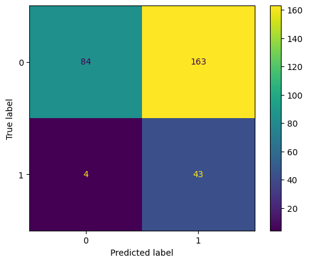
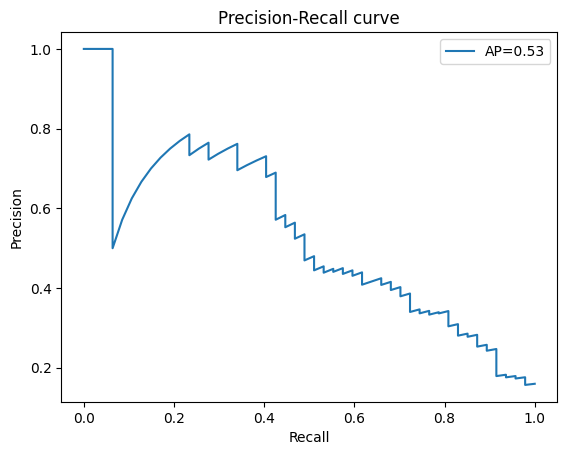
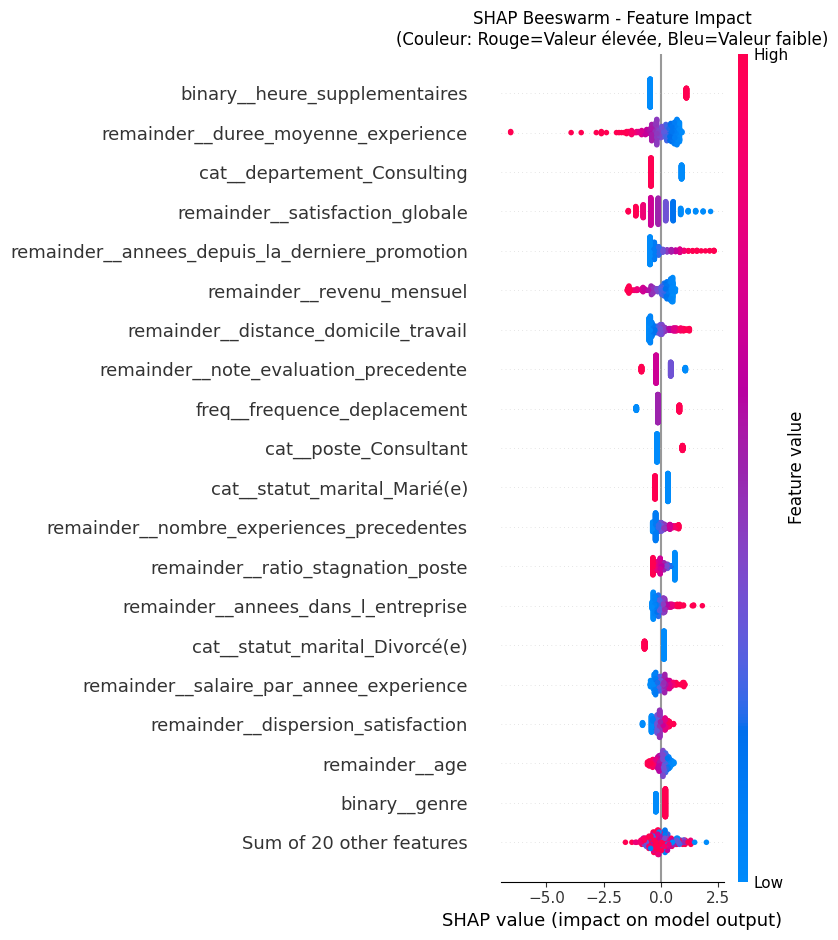
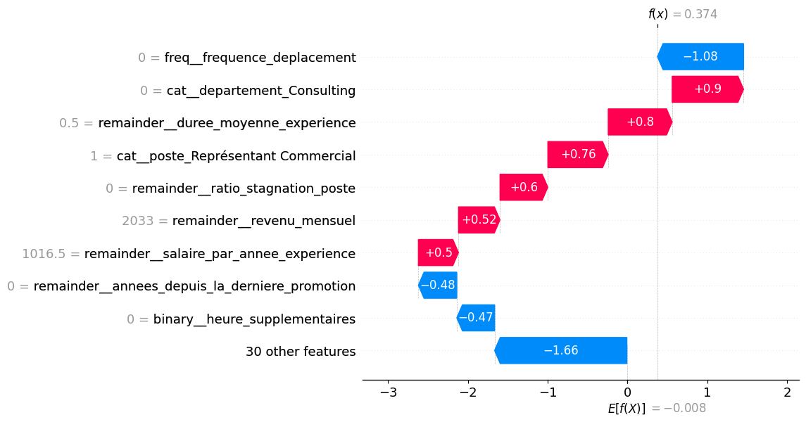
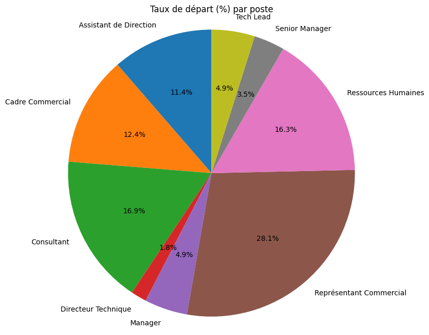

# Analyse de l’attrition au sein d’une ESN

## Présentation

Ce projet a pour objectif d’identifier les facteurs associés à l’attrition des salariés au sein d’une ESN.

L’analyse repose sur trois sources de données RH :

- les évaluations des employés ;
- les informations issues du SIRH ;
- les réponses à un sondage de satisfaction.

La variable cible est `a_quitte_l_entreprise`, qui indique si un salarié a quitté l’entreprise.

## Objectifs

- Explorer les caractéristiques des salariés ;
- Identifier les facteurs associés aux départs ;
- Créer de nouvelles variables explicatives ;
- Étudier les corrélations et la multicolinéarité ;
- Comparer plusieurs modèles de classification ;
- Optimiser la détection des salariés susceptibles de quitter l’entreprise ;
- Interpréter les prédictions avec SHAP.

## Données

Les fichiers utilisés sont :

```text
extrait_eval.csv
extrait_sirh.csv
extrait_sondage.csv
```

Les données sont reliées grâce aux identifiants salariés :

- `extrait_eval.eval_number` : identifiant au format `E_1` ;
- `extrait_sirh.id_employee` : identifiant numérique ;
- `extrait_sondage.code_sondage` : identifiant numérique.

Le préfixe `E_` est supprimé avant la jointure.

## Notebook

L’analyse complète est disponible dans :

```text
P04_15122025.ipynb
```

Le notebook contient les étapes suivantes :

1. Import des bibliothèques ;
2. Chargement des fichiers CSV ;
3. Visualisation et description des jeux de données ;
4. Jointure des trois sources ;
5. Exploration des valeurs uniques et des éventuelles anomalies ;
6. Analyse des relations avec l’attrition ;
7. Création de variables explicatives ;
8. Analyse des corrélations et du VIF ;
9. Construction des pipelines de machine learning ;
10. Entraînement et optimisation des modèles ;
11. Analyse des importances des variables ;
12. Interprétation avec SHAP.

## Variables créées

### Satisfaction

Les quatre variables de satisfaction sont regroupées afin de créer :

- `satisfaction_globale` : moyenne des quatre dimensions de satisfaction ;
- `dispersion_satisfaction` : écart-type des niveaux de satisfaction.

Les variables originales de satisfaction sont ensuite supprimées dans la fonction `features`.

### Ancienneté et expérience

Les variables suivantes sont calculées :

- `ratio_fidelite` ;
- `ratio_stagnation_poste` ;
- `duree_moyenne_experience`.

Les divisions par zéro sont évitées en remplaçant les valeurs nulles par `1`.

### Salaire

Les variables suivantes sont créées :

- `salaire_par_annee_experience` ;
- `salaire_vs_poste` ;
- `salaire_vs_niveau`.

Les variables comparatives sont calculées à partir de la moyenne du salaire par poste ou par niveau hiérarchique.

## Prétraitement

Le notebook applique plusieurs transformations :

- encodage binaire du genre ;
- encodage binaire des heures supplémentaires ;
- conversion des pourcentages d’augmentation salariale ;
- encodage ordinal de la fréquence des déplacements ;
- encodage one-hot des variables catégorielles.

Les variables catégorielles nominales comprennent notamment :

- `statut_marital` ;
- `departement` ;
- `poste` ;
- `domaine_etude`.

La variable cible `a_quitte_l_entreprise` est encodée séparément dans la partie modélisation.

## Modèles utilisés

Les modèles testés sont :

- `DummyClassifier` comme modèle de référence ;
- `LogisticRegression` ;
- `RandomForestClassifier`.

Les modèles sont intégrés dans des pipelines comprenant :

- un `ColumnTransformer` ;
- un encodage des variables ;
- une gestion du déséquilibre des classes avec `class_weight` ;
- éventuellement `SMOTE` et `EditedNearestNeighbours`.

Une classe `ModelHandler` est utilisée pour :

- construire les pipelines ;
- effectuer une validation croisée stratifiée ;
- rechercher les meilleurs hyperparamètres avec `GridSearchCV` ;
- évaluer les modèles.

## Évaluation

Les métriques utilisées sont :

- précision ;
- rappel ;
- F1-score ;
- ROC AUC ;
- F-beta avec `beta=2` ;
- F-beta avec `beta=5` ;
- matrice de confusion ;
- courbe ROC ;
- courbe précision-rappel.

## Résultats des modèles

Les résultats ci-dessous correspondent au jeu de test, sauf indication contraire.

| Modèle | Précision — Oui | Rappel — Oui | ROC AUC |
|---|---:|---:|---:|
| DummyClassifier | Non communiqué | Non communiqué | Non communiqué |
| LogisticRegression | 0,55 | 0,28 | 0,80 |
| RandomForestClassifier | Non communiqué | Non communiqué | Non communiqué |

### Résultats complémentaires

Pour la régression logistique :

| Jeu de données | Précision — Oui | Rappel — Oui | ROC AUC |
|---|---:|---:|---:|
| Entraînement | 0,83 | 0,45 | 0,86 |
| Test | 0,55 | 0,28 | 0,80 |

Avec un seuil de classification fixé à `0,1`, le rappel sur le jeu de test atteint `0,97`.

Une attention particulière est portée au rappel et aux scores F-beta afin de mieux détecter les salariés susceptibles de quitter l’entreprise.

Le seuil de classification est également étudié pour mesurer son influence sur la précision et le rappel.

## Interprétabilité avec SHAP

Le notebook utilise SHAP pour interpréter les prédictions du modèle de régression logistique.

Les analyses réalisées comprennent :

- l’importance globale des variables ;
- les graphiques beeswarm ;

- les graphiques waterfall ;

- l’analyse de l’impact du salaire ;
- l’analyse de l’impact de la satisfaction ;
- l’analyse de l’ancienneté ;
- l’étude de variables individuelles avec des graphiques scatter.



Les valeurs SHAP peuvent être sauvegardées dans :

```text
shap_values.pkl
shap_values.csv
```

## Installation avec uv

Installer les dépendances du projet à partir de `pyproject.toml` :

```powershell
uv sync
```

Créer ou mettre à jour l’environnement virtuel :

```powershell
uv venv
uv sync
```

Installer le support Jupyter si nécessaire :

```powershell
uv add jupyter ipykernel
```

Enregistrer l’environnement comme kernel Jupyter :

```powershell
uv run python -m ipykernel install --user --name projet04-bis --display-name "Python (projet04-bis)"
```

## Exécution

Lancer Jupyter Notebook avec `uv` :

```powershell
uv run jupyter notebook
```

Ou ouvrir directement le notebook dans Visual Studio Code :

```powershell
code P04_15122025.ipynb
```

Les fichiers CSV doivent être placés à la racine du projet, au même niveau que le notebook.

## Structure du projet

```text
projet04_bis/
├── .github/
│   └── copilot-instructions.md
├── extrait_eval.csv
├── extrait_sirh.csv
├── extrait_sondage.csv
├── P04_15122025.ipynb
├── pyproject.toml
├── uv.lock
├── shap_values.csv
├── shap_values.pkl
└── README.md
```

## Limites

- Les résultats dépendent de la qualité et de la représentativité des données ;
- les corrélations observées ne prouvent pas nécessairement une causalité ;
- les résultats doivent être utilisés comme une aide à la décision RH ;
- les prédictions ne doivent pas servir à prendre automatiquement des décisions individuelles ;
- l’utilisation de variables liées aux salariés doit respecter les règles de confidentialité et de non-discrimination.

## Conclusion

Ce projet permet d’explorer les facteurs liés à l’attrition dans une ESN et de construire des modèles capables d’identifier les profils présentant un risque de départ.

Les résultats peuvent contribuer à définir des actions de fidélisation portant notamment sur :

- la satisfaction au travail ;
- l’évolution professionnelle ;
- la reconnaissance ;
- la rémunération ;
- l’ancienneté dans le poste ;
- les conditions de travail.